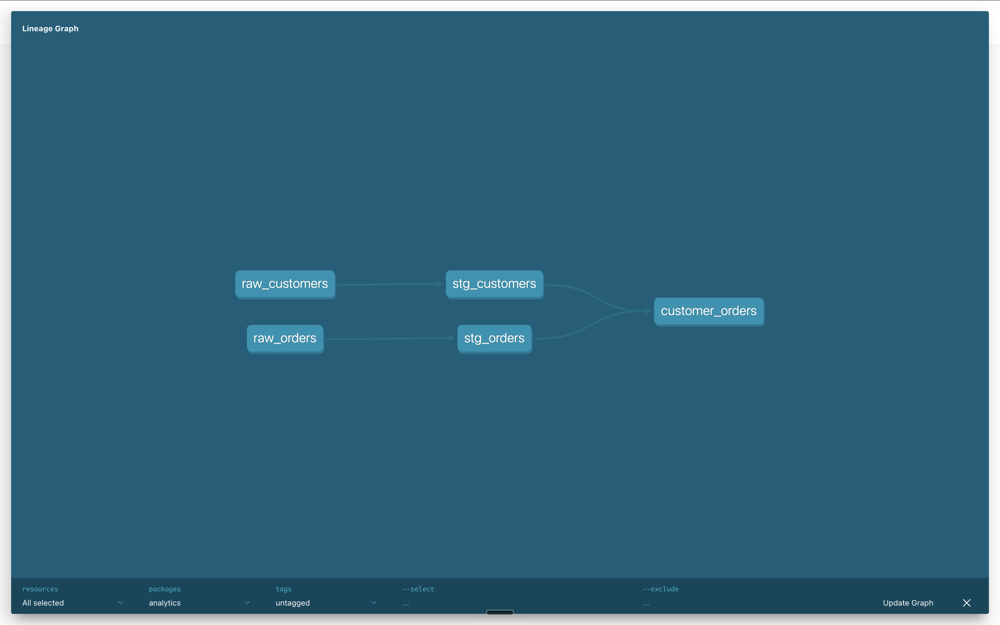

# dbt analytics engineering

A small dbt project that builds the same staging and mart models on either DuckDB (local file, no setup) or Snowflake, selected by dbt target. Two CSV seeds feed two staging views and one customer-level mart, with schema tests on every primary key.

## At a glance

| | |
|---|---|
| Stack | dbt-core, dbt-duckdb, dbt-snowflake |
| Warehouse | DuckDB (default `dev` target) or Snowflake (`snowflake` target) |
| Data | Two seed CSVs: `raw_customers` (6 rows) and `raw_orders` (12 rows) |
| What it shows | One codebase building on two warehouses, staging to marts layering with `ref()`, `unique` and `not_null` tests, a committable example profile with key-pair auth for Snowflake |
| Status | Portfolio project, complete. Last verified 2026-06 from the repo contents. |

## Architecture



```
seeds                staging (views)        marts (table)
-----                ---------------        -------------
raw_customers  -->   stg_customers   --+
                                       +-->  customer_orders
raw_orders     -->   stg_orders      --+
```

- `seeds/`: `raw_customers.csv`, `raw_orders.csv`.
- `models/staging/`: 1:1 cleanup of the seeds (rename keys, cast types), materialized as views per `dbt_project.yml`.
- `models/marts/`: `customer_orders`, materialized as a table.
- `profiles.example.yml`: one profile, two outputs. The Snowflake output uses a dedicated service-account user with `snowflake_jwt` key-pair auth, scoped to a sandbox role and database. The real `profiles.yml`, `*.p8` keys and `*.duckdb` files are git-ignored.

`analyses/`, `macros/`, `snapshots/` and `tests/` exist but are empty.

## Run it

```bash
git clone https://github.com/nathanmars7/dbt-analytics-engineering.git
cd dbt-analytics-engineering

python3 -m venv .venv
source .venv/bin/activate
pip install -r requirements.txt

# Profile: the default target is DuckDB and needs no edits.
# Fill in the Snowflake placeholders only if you want that target.
mkdir -p ~/.dbt
cp profiles.example.yml ~/.dbt/profiles.yml

dbt seed            # load the two CSVs
dbt build           # run models and tests
dbt docs generate   # then: dbt docs serve
```

Add `--target snowflake` to any command to run against Snowflake instead:

```bash
dbt build --target snowflake
```

There is no `packages.yml`, so `dbt deps` is not needed.

## Models

| Model | Materialization | Description |
|---|---|---|
| `stg_customers` | view | One row per customer from `raw_customers`; renames `id` to `customer_id` and casts types. Tests: `unique`, `not_null` on `customer_id`. |
| `stg_orders` | view | One row per order from `raw_orders`; renames `id` to `order_id`, casts `order_date`, `amount` and `status`. Tests: `unique`, `not_null` on `order_id`. |
| `customer_orders` | table | One row per customer from `stg_customers LEFT JOIN stg_orders`, so customers with no orders appear with zeroed metrics: `total_orders`, `total_spend`, `avg_order_value`, `completed_orders`, `returned_orders`. Tests: `unique`, `not_null` on `customer_id`. |

## Portfolio

Part of a set of data engineering portfolio projects:

- https://github.com/nathanmars7/dbt-analytics-engineering : dbt on DuckDB and Snowflake from one codebase (this repo)
- https://github.com/nathanmars7/jaffle-shop-snowflake : minimal dbt starter on Snowflake
- https://github.com/nathanmars7/dbt-nyc-citibike : dbt on BigQuery, Citibike ridership vs weather
- https://github.com/nathanmars7/dbt-crypto-bitcoin : dbt on BigQuery with snapshots, Bitcoin transactions
- https://github.com/nathanmars7/dbt-learning : dbt on BigQuery, Chicago taxi trips, incremental models
- https://github.com/nathanmars7/pyspark-fraud-pipeline : PySpark and Delta Lake medallion pipeline on Databricks
